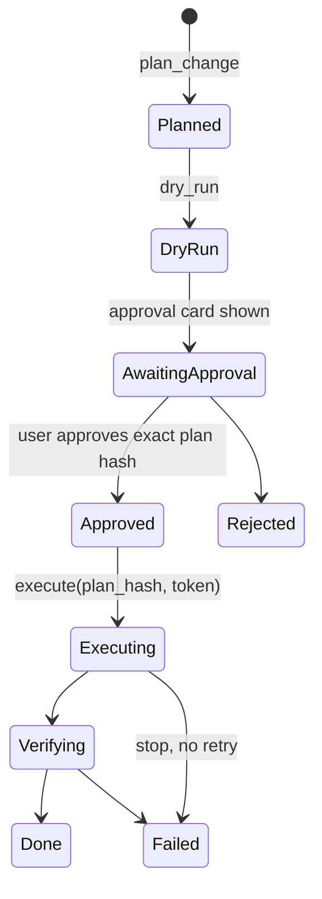

# Release Gate MCP: implementation plan

**Status: planning; not implemented.**

## Problem and goal

Production changes often require an explicit, auditable approval describing the command, target, effect and rollback, preceded by a dry run and followed by verification. Manual preflight, provider-specific CLI behavior and scattered records make that process error-prone.

Build an MCP server for typed, gated operations: **plan → dry run → approval card → execute → verify → record**. A write through the server requires a matching, unexpired approval token for the exact plan. The server does not replace CI/CD or manage secret values; it uses secret references only. This guarantee applies to operations routed through the server, not direct provider access.

## Model and policy

- Canonical JSON identifies the provider, target, commands and arguments, and artifact digests. Approval is bound to its hash; any change requires a new plan, dry run and approval.
- A per-project policy distinguishes read-only operations, approved writes and actions needing separate approval, including production releases, rollout percentages, prices, deletes, permissions and secrets. Batch only as policy permits; never batch production actions.
- Approval is explicit, time-limited and obtained through the host's approval interface. Fail closed if approval or dry-run evidence is absent or does not match. Stop on failure; do not retry a write automatically.
- The approval card states **what** (exact commands), **where** (provider project, app, track and environment as applicable), **effect** (dry-run result), **rollback** (or irreversible), and separate-approval flags.

## Provider adapters

Supabase is the first-class M1 adapter, not a deferred integration. Each adapter owns provider-specific CLI flags and version compatibility and supplies dry run, execution, verification and rollback guidance. A provider operation without a genuine dry run must show an accurate before/after diff or clearly disclose the limitation before approval; never present execution as a dry run.

| Provider | Planned operations | Milestone |
|---|---|---|
| Supabase | Database push with pending-migration dry run, read-only SQL checks; function deploy and secrets by reference | M1: database push and read-only checks; later: functions and secret references |
| Google Play | Preflight, upload to track, release notes, rollout percentage, halt, promote; read tracks, vitals and reviews | M2 |
| Cloudflare | Pages deploy from a committed directory; DNS and routing changes with before/after diffs | M3 |
| Google Cloud | IAM read/diff and bindings; API enable/disable using supported dry runs or policy diffs | M3 and later |

The Supabase adapter handles non-interactive hosted-write requirements, uses read-only mode for checks, and avoids deprecated CLI options. Provider versions and supported capabilities must be documented and pinned where appropriate rather than assuming flags remain stable.

## Verification and ledger

Verification is provider-specific and records evidence rather than assuming a successful command means a successful change:

- Supabase migration: a subsequent database dry run reports no pending migrations; project-declared read-only checks can assert expected schema or scheduled-job state.
- Play: track state lists the intended version and release name.
- Pages: fetch the deployed URL and check expected content.

Maintain an append-only JSONL ledger per project containing the plan, dry-run output digest, approver and time, execution output, verification and commit links. Render a Markdown changelog section on demand. Avoid storing secret values in plans, output or the ledger.

## MCP tool surface

`plan_change`, `dry_run`, `request_approval`, `execute`, `verify`, `ledger_list`, `ledger_render`, and read-only provider `status`.

## Milestones

1. **M1 — Supabase:** state machine, canonical plan hashing, project policy, approval enforcement and append-only ledger; Supabase database push with migration dry run, execution, verification and read-only SQL checks.
2. **M2 — Play:** preflight, locale-specific release-note length checks, track upload and verification. Exercise the workflow using synthetic app and release fixtures, not private production replays.
3. **M3 — Cloudflare and Google Cloud:** Pages and DNS adapters, plus GCP IAM read/diff; expand provider operations as supported dry runs and verification are available.
4. **M4 — broader policy and reporting:** extend separate-approval rules across later adapters, rollback guidance and rendered changelog; add Supabase function deployment and secret-reference operations.

## Testing and risks

Use synthetic project, app, schema, migration and CLI-output fixtures. Cover adapter behavior including non-interactive refusals, plan changes invalidating approval, expired or mismatched approvals, failed execution and failed verification. Never require private app identifiers or production data. Provider CLI changes can invalidate assumptions: pin supported versions and keep flag knowledge in adapters. Approval fatigue is a risk: batch only within policy and never batch production actions.

## Kit compatibility

This tool is also a component of [android-kit](https://github.com/fridaysundaymood/android-kit/blob/main/IMPLEMENTATION_PLAN.md). From its first milestone it follows the kit composability rules: the shared result schema (`kit-schema`), its own section in `android-kit.yaml`, artifacts under `.android-kit/runs/<run-id>/<tool>/`, prefixed MCP tool names, a library-first design with thin CLI and MCP adapters, and tests against the shared synthetic `kit-fixture-app`.
