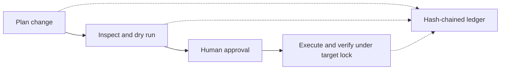
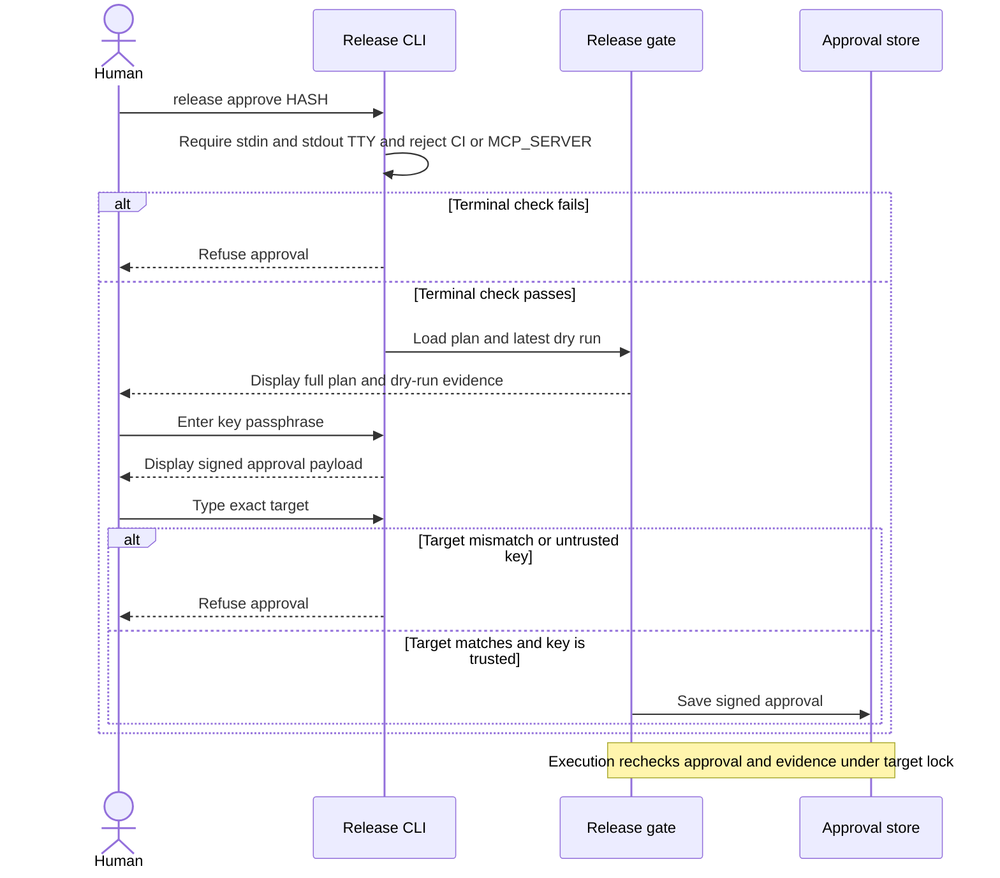

# Release Gate MCP

Release Gate routes supported changes through plan, dry run, human approval, execution, verification and a hash-chained ledger. It is a Node.js 24 TypeScript library, CLI and tools-only MCP server. It does not prevent direct provider access.

The release workflow records plans, dry runs and execution outcomes in the ledger, with approval performed separately by a human.



## Installation

Install `@budaknyenyel/supa-release-gate-mcp` from npm, or clone `android-kit`, `kit-fixture-app` and this repository as siblings for local development. Build the shared schema, install and build this project:

```sh
cd ../android-kit && npm ci && npm run build
cd ../supa-release-gate-mcp && npm ci && npm run build
node dist/cli/index.js keys init
```

The human chooses a passphrase in a terminal. The encrypted Ed25519 key and `trusted-approvers.json` are stored under the user configuration directory. Put the following host-controlled configuration in the user config directory under `supa-release-gate/config.yaml`, outside the project. Alternatively set `RELEASE_GATE_CONFIG` or pass `--config` to the CLI. The gate refuses authority paths inside the project:

Passphrases must contain at least 20 characters and 8 distinct characters. Version 2 keys use scrypt with N=131072; regenerate older keys. Approval lifetimes are limited to 15 minutes. The `separate-approval` policy mode is no longer supported.

```yaml
releaseGate:
  directory: ./authority
  approvalDirectory: ./approvals
  trustedApproversFile: ./trusted-approvers.json
  policies:
    - provider: supabase
      target: example
      operation: db-push
      id: production
      mode: write
  providers:
    supabase:
      projectRef: example
      workdir: .
      cli: /absolute/protected/path/to/supabase
```

Replace the illustrative target with an operator-controlled value; hosted Supabase project references must match the linked project. The configuration directory, trust file, ledger, approvals, and any configured executor or executable must be protected from the agent using operating-system permissions. On Windows, use explicit ACLs and check them with `release doctor`. Keep credentials in environment variables or another protected credential store, not plans or configuration. Read-only SQL checks require genuinely read-only credentials; a read-only transaction alone cannot prevent side effects in privileged functions.

For `secrets-set`, list the exact permitted environment variable names in the matching policy's `secretEnvAllowlist`. No names are allowed by default. Provider access-token and database connection variables, and reserved credential prefixes, cannot be referenced even if listed.

Play bundle paths must resolve inside the project. Configure `providers.cloudflare.pagesRoot` inside the project to constrain Pages deployment directories. Supabase and Pages execute from isolated verified snapshots; Play uploads the same bytes whose digest is checked against the approval.

Prepare a JSON plan with `provider`, `target`, `operation`, and the matching `policy` object (`id`, `mode`), plus operation-specific arguments. Then:

```sh
node dist/cli/index.js doctor --json
node dist/cli/index.js plan plan.json --json
node dist/cli/index.js dry-run <plan-hash> --json
# Human only, in an interactive terminal after reviewing the full plan and evidence:
node dist/cli/index.js approve <plan-hash>
node dist/cli/index.js approval-status <plan-hash> --json
node dist/cli/index.js execute <plan-hash> --json
node dist/cli/index.js verify <plan-hash> --json
node dist/cli/index.js ledger render --json
```

A generic MCP client can launch `release-mcp` with the host configuration path, or set `RELEASE_GATE_CONFIG` in its launch environment. Run it with the project as its working directory. MCP exposes `release_plan_change`, `release_dry_run`, `release_approval_status`, `release_execute`, `release_verify`, `release_recover`, `release_ledger_list`, `release_ledger_render`, `release_status` and `release_doctor`; it does not expose approval or key creation.

## Who can approve

Approval is a separate human action, not an MCP tool. The terminal and passphrase must be protected from the agent; TTY checks alone do not establish that boundary.



## Trust and recovery

The human must keep the key passphrase private. TTY checks and encrypted keys protect the workflow only when the agent cannot access the passphrase or control the terminal. They are not protection from a fully malicious process running as the same OS user. For stronger isolation run the executor and credentials under a separate OS identity, protect the gate executable, config, trust store and state with OS ACLs, and configure `externalExecutor` as the protected executable. It receives JSON `{plan, approval}` on stdin and must independently authenticate approval and recheck provider state; the invoking process cannot enforce the executable's OS boundary. See [SECURITY.md](SECURITY.md).

Approvals bind a gate identity, plan, target, policy, dry-run evidence, issuance time, expiry and a single-use nonce. The gate rechecks state under a per-target lock and executes verified private artifact copies; Pages uses the approved Git commit. External provider changes may race operations without conditional writes. An interrupted write is not retried; run `release recover <plan-hash>` or `release_recover` to reconcile its intent against provider state. If unresolved, a human must investigate and record the outcome using `release resolve <intent-id> --status succeeded|failed --evidence evidence.json` in an interactive terminal; there is no MCP resolution command. Protect and independently anchor ledger heads: the hash chain does not detect deletion or replacement of the entire ledger.

Supabase function and secret operations do not offer provider dry runs; their evidence discloses the limitation and metadata-only verification cannot establish deployed content. Play dry-run creates and validates an uncommitted edit, potentially uploading artifacts, then deletes the edit. Cloudflare DNS and Pages have no conditional gate lock against out-of-band changes. Live Play, Cloudflare and Google Cloud use requires the appropriate credentials and permissions.

## Development

Run `npm run lint`, `npm run build`, and `npm test`. The isolated local Supabase integration uses Docker, the pinned Supabase CLI and sibling fixture migrations: `node test/local-supabase.mjs`. It owns only the `ak-release` local stack. See [CONTRIBUTING.md](CONTRIBUTING.md). No telemetry is collected.

[MIT](LICENSE)
